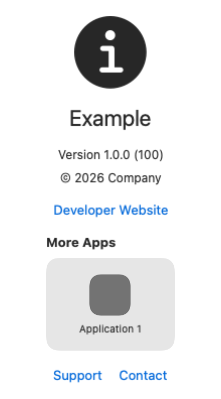
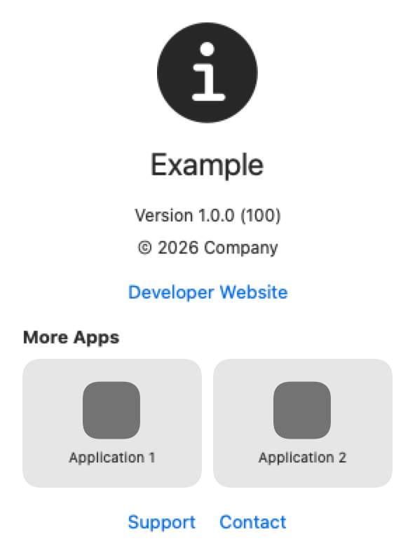
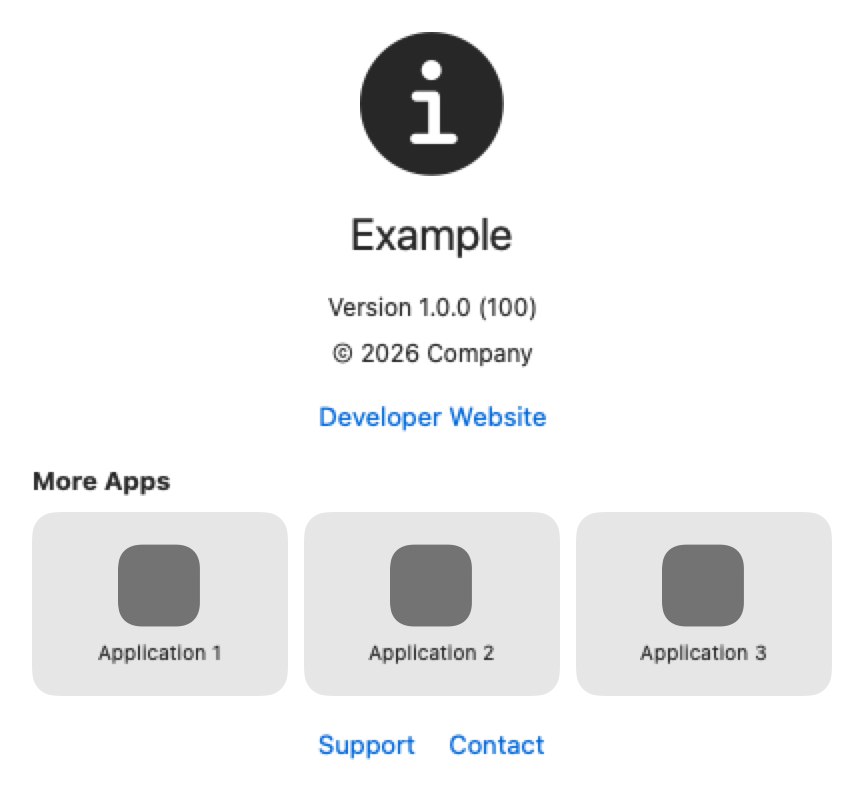
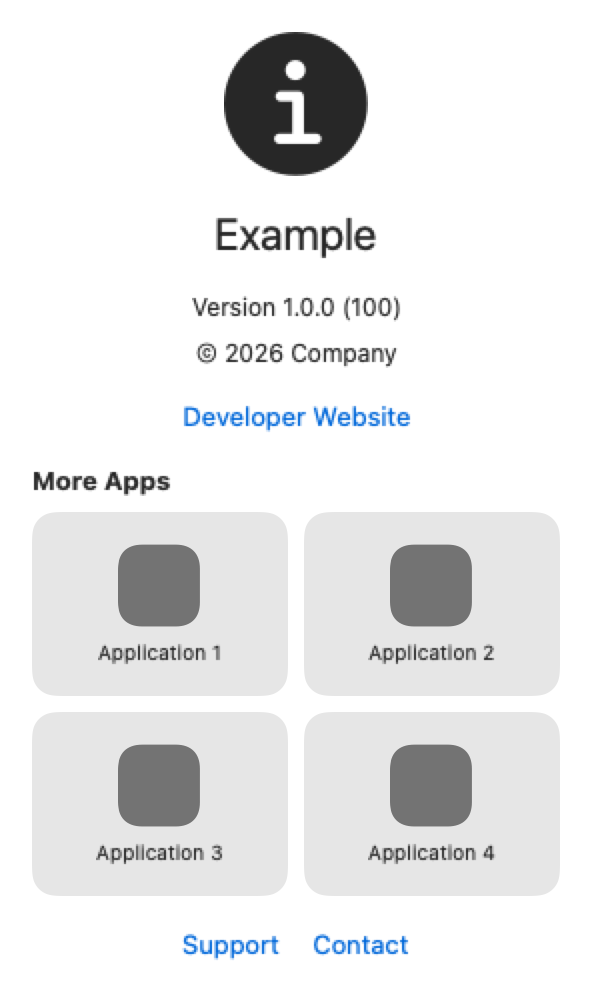
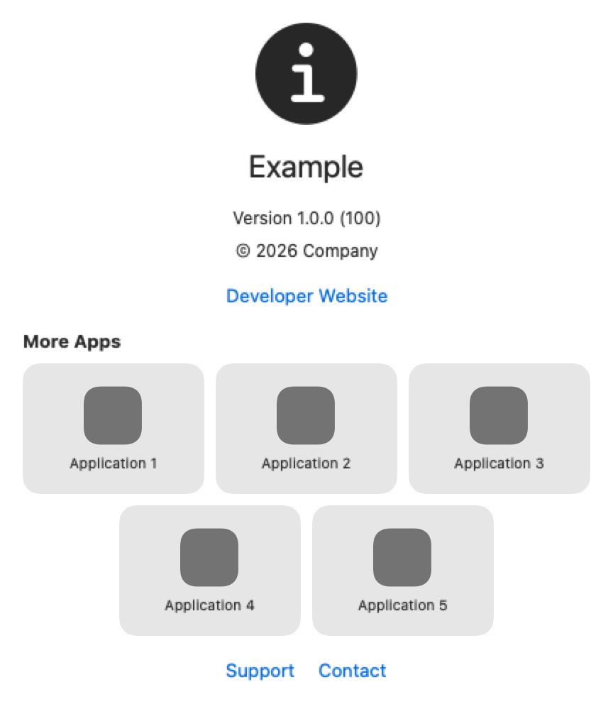
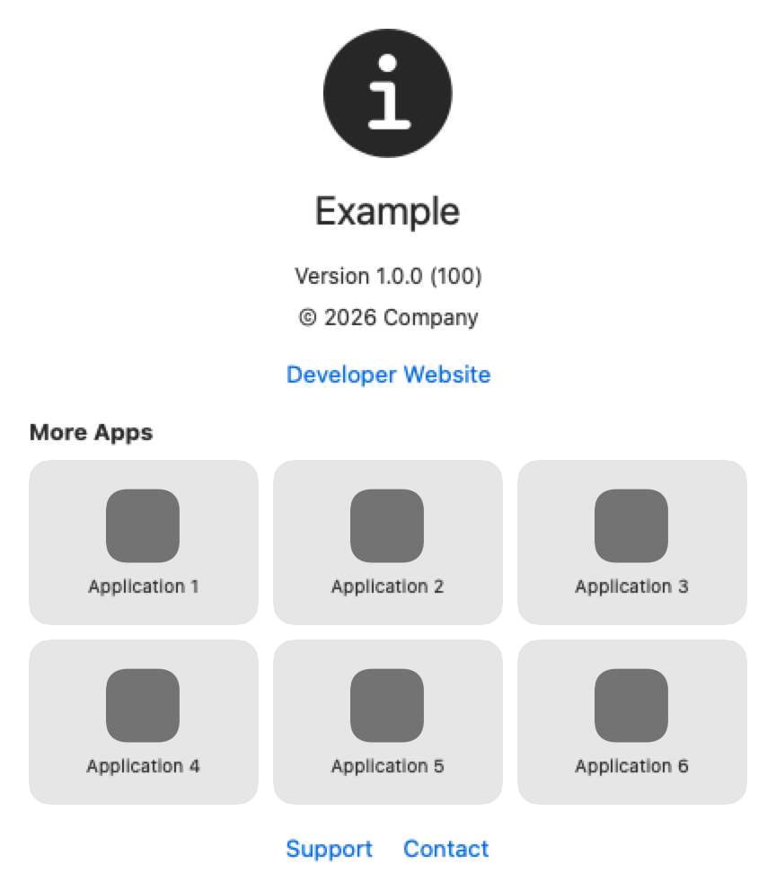

# CustomizedAboutView

`CustomizedAboutView` is a customizable SwiftUI about screen for every Apple platform. It reads localized application metadata from a bundle and can load related applications from the App Store.

## Platforms

[](https://developer.apple.com/ios/)
[](https://developer.apple.com/mac-catalyst/)
[](https://developer.apple.com/macos/)
[](https://developer.apple.com/tvos/)
[](https://developer.apple.com/watchos/)
[](https://developer.apple.com/visionos/)

## Installation

Add `https://github.com/Agnidia/CustomizedAboutView.git` as a Swift Package dependency.

## Default content

```swift
import CustomizedAboutView
import SwiftUI

CustomizedAboutView(
    configuration: .init(
        appStoreIDs: [1_583_462_846, 6_471_902_188, 1_661_688_468],
        developerWebsite: URL(string: "https://example.com"),
        supportWebsite: URL(string: "https://example.com/support"),
        contactWebsite: URL(string: "https://example.com/contact")
    )
) {
    Image("AboutIcon")
        .resizable()
        .scaledToFit()
        .frame(width: 96, height: 96)
}
```

For a macOS window, let SwiftUI derive the window size from the content:

```swift
Window("About", id: "about") {
    aboutView
}
.windowResizability(.contentSize)
```

The default content uses a minimum macOS size of 220 × 330 points and grows with its content.

The default metadata initializer reads these localized bundle values:

- `CFBundleDisplayName`, with `CFBundleName` as a fallback
- `CFBundleShortVersionString`
- `CFBundleVersion`
- `NSHumanReadableCopyright`

## Application layouts

The default layout arranges up to six application cards automatically. Rows with fewer cards are centered.

## Preview gallery

| 1 app | 2 apps | 3 apps |
|---|---|---|
|  |  |  |
| 4 apps | 5 apps | 6 apps |
|  |  |  |

## Full customization

Replace the complete presentation while retaining bundle metadata and App Store loading:

```swift
CustomizedAboutView(configuration: configuration) { context, strings in
    VStack {
        Text(context.configuration.metadata.name)

        if case let .loaded(applications) = context.appsState {
            ForEach(applications) { application in
                Link(application.name, destination: application.storeURL)
            }
        }

        Button(strings.retry, action: context.reload)
    }
}
```

The default English and Ukrainian localizations follow the SwiftUI environment locale. Pass `CustomizedAboutStrings` to provide any localization or wording.

The App Store client is injectable. Tests and offline applications can supply a custom `AppStoreLookupClient`.

## Documentation

Read the [DocC documentation](Sources/CustomizedAboutView/CustomizedAboutView.docc/CustomizedAboutView.md) for setup, customization, and the complete preview gallery.

## License

CustomizedAboutView is available under the MIT license.
